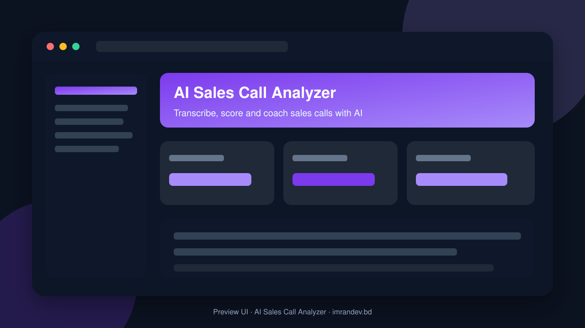
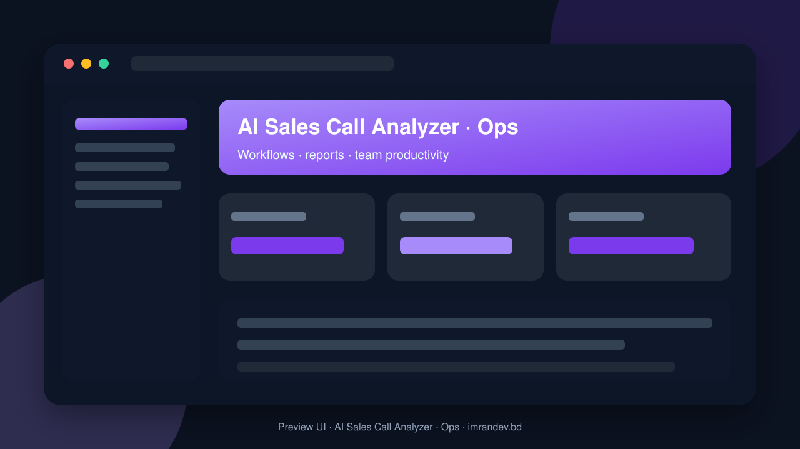

<p align="center">
  
</p>

<h1 align="center">AI Sales Call Analyzer</h1>

<p align="center"><strong>Transcribe, score and coach sales calls with AI</strong></p>

<p align="center">
  <a href="https://github.com/imranbru99/ai-sales-call-analyzer-transcribe-score"></a>
  
  
</p>

---

## Overview

**AI Sales Call Analyzer** is a complete business application focused on real operational workflows. This README lists the full feature surface so GitHub visitors and search engines can understand every capability of the product.

## Product preview

| Dashboard | Operations |
| :---: | :---: |
|  |  |

## Complete feature list

### Product modules & capabilities

- MASTER PROMPT
- MySQL 8
- Dashboard foundation for admin/manager/agent panels
- All AI calls
- Attendance machine integration
- Module system
- Super Admin
- Branch Manager
- Sales Manager / Team Lead
- Finance / Accountant
- Customer / Lead Portal User
- Upload audio/video
- Multi-provider via laravel-ai-hub
- Speaker diarization
- Custom vocabulary/glossary per business
- PII detection and redaction
- Overall call score
- Call summary
- Sentiment and emotion timeline
- Intent & outcome classification
- Prompt template manager
- Manager listen / whisper / barge for supported telephony
- Real-time compliance alerts
- Auto-generated coaching feedback per call and per agent
- Best-practice clips auto-extracted from top calls
- Review queues with sampling rules
- Lead enrichment via laravel-ai-catalog
- Agent availability and call-handling stats
- Invoices/receipts
- CSAT/NPS survey after calls
- Pages
- Solutions by role
- Live Demo
- Security & Compliance
- Compare pages
- Sales Manager
- Finance
- Customer Portal
- Per-tenant data isolation tests
- Complete feature list organized by module
- Module catalog table
- Architecture diagram
- Deployment guide
- HR/attendance
- Public website + CMS
- Test suite passes

### Admin / Filament resources

- Call
- Coaching Plan
- Compliance Rule
- Contact
- Deal
- My Call
- Plan
- Qa Review
- Scorecard
- Shared Call
- Tenant Module
- Tenant

### Domain models

- Battlecard
- Belongs To Branch
- Belongs To Tenant
- Blog Post
- Branch
- Branch Scope
- Call
- Call Annotation
- Call Score
- Campaign
- Campaign Lead
- Case Study
- Cms Page
- Coaching Action
- Coaching Plan
- Commission Plan
- Compliance Rule
- Compliance Violation
- Contact
- Csat Survey
- Deal
- Faq
- Integration
- Invoice
- Module
- Payroll Record
- Plan
- Qa Review
- Scorecard
- Script
- Shift
- Support Ticket
- Team
- Tenant
- Tenant Module
- Tenant Scope
- Testimonial
- Transcript Segment

### HTTP / API controllers

- Demo Login APIs & screens
- Public Website APIs & screens

### Detailed feature requirements delivered

- MASTER PROMPT — AI Sales Call Analyzer (Laravel + Filament)
- Mission & Positioning
- Product name: AI Sales Call Analyzer
- Tagline: Every call transcribed, scored, and turned into revenue.
- Goal: the best sales-call intelligence platform in the world — usable by a 3-person startup, a call center with 500 agents, an agency, or an enterprise with many branches.
- Tech Stack (mandatory)
- Storage: local + S3-compatible driver (configurable); audio files stored privately with signed URLs
- Testing: Pest/PHPUnit, Larastan (level 6+), Laravel Pint
- Attendance machine integration (biometric/RFID/face devices) for the Attendance & Shift module of call-center agents
- All PDF exports in any language (call reports, scorecards, coaching plans, invoices, payslips) with correct Bangla, Arabic, Hindi, CJK rendering
- Architecture Rules
- Dependency handling: enabling a module auto-suggests dependencies; disabling warns about dependents.
- Everything auditable: activity log on all create/update/delete, login history, exports, recording plays, and transcript views.
- Fully localized (i18n): English + Bangla + Arabic + Hindi + Spanish + French at minimum, RTL support, per-user language and timezone, per-tenant currency and date formats.
- API-first: every module exposes a versioned REST API (/api/v1) with Sanctum tokens, OpenAPI docs, rate limits, and webhooks (outgoing, signed with HMAC).
- User Types (all must have a working panel/portal and a demo user)
- Platform panel: tenants, plans, module catalog, global AI providers, billing, system health, impersonation, announcements
- Everything in their business: modules, billing, branches, users, settings
- Public/portal view: own call summaries (if shared), consent management, booking, feedback/CSAT
- Modules (ALL are required; each is toggleable per business)
- Audio pre-processing: normalization, noise reduction, silence trimming, channel split (agent vs customer), format conversion (ffmpeg)
- Methodology frameworks built in: BANT, MEDDIC, SPIN, Challenger, SPICED, Sandler — AI checks which elements were covered
- AI "why this score" explanations with evidence quotes and timestamps (click to jump to audio)
- Prompt template manager (versioned prompts per task, per tenant), model selection per task, cost tracking per analysis, batch processing with budgets
- Human-in-the-loop: QA override, agent dispute workflow, calibration sessions across QA analysts, inter-rater agreement stats
- Searchable library: full-text + semantic (embeddings) search across transcripts ("find calls where customers mention a competitor's price")
- Filters: agent, team, branch, date, score range, sentiment, outcome, topic, tag, language, duration, campaign
- Bulk actions: tag, assign, export, delete, re-score
- Rule builder: required phrases (disclosures, recording notice), forbidden phrases, regulated-claims detection, mandatory verification steps
- Industry packs: financial services, insurance, healthcare (HIPAA-style), debt collection, telecom, microfinance, real estate
- Consent management, DNC (do-not-call) list checking, retention policies per tenant/region, legal hold, right-to-erasure/GDPR tools, audit export
- Lead enrichment via laravel-ai-catalog (scrape company website, public info) with source tracking
- Two-way sync with external CRMs: HubSpot, Salesforce, Zoho, Pipedrive, Odoo, Freshsales, GoHighLevel (connectors with field mapping UI)
- Campaign analytics: contact rate, conversion, cost per lead, best time to call
- Dashboards: executive, branch, team, agent, QA, compliance, campaign, revenue-impact
- Revenue attribution: link scores and behaviors to closed deals
- Chat with all your calls: "Why did we lose deals this month?", "Summarize objections about pricing last week", with citations to specific calls and timestamps
- Basic payroll: salary structure, deductions, payslips (PDF in any language), bank/mobile-wallet payout files
- Payment gateways: Stripe, PayPal, Paddle, SSLCommerz, bKash, Nagad, Razorpay, manual/bank transfer with approval
- Invoices/receipts (PDF via laravel-unicode-pdf), tax/VAT, credit notes, dunning, wallet/credits top-up
- Public Website (many pages, all fully designed and responsive)
- Resources: Docs / Knowledge base, API docs, Changelog, Roadmap, Webinars, Templates (scorecard templates, scripts library — downloadable)
- Legal: Terms, Privacy, DPA, Cookie policy, Acceptable use, SLA
- Auth pages: Login, Register (tenant sign-up wizard with business-type → preset → module selection), Forgot password, Verify email
- Demo Data & Demo Users (mandatory)
- Database & Performance Requirements
- Eager loading everywhere, no N+1 (enable Model::preventLazyLoading() in non-production), cache heavy dashboards, use drutogoti for speed optimizations
- Large file handling: chunked/resumable uploads, streaming audio with range requests, signed URLs
- Horizon queues separated: ingest, transcribe, analyze, notify, reports, default
- Security & Privacy Requirements
- UI/UX Requirements
- Separate Filament panels: Platform (Super Admin), Business (Owner/Manager/Staff), Agent, Portal (Customer/Reseller)
- Dashboard widgets with date-range and branch filters; command palette (Ctrl+K); keyboard shortcuts; notifications center
- Onboarding wizard for new tenants: business type → preset → modules → branches → invite users → connect telephony → upload first call → see first score in minutes
- README.md (required deliverable)
- Configuration guide: AI providers via laravel-ai-hub, telephony connectors, storage, mail/SMS, payment gateways, attendance machines
- Execution Plan (follow in order; commit after each phase)
- Foundation: install Laravel + Filament + all required packages; tenancy, branches, auth, roles/permissions, module manager, settings, activity log, i18n
- Analytics, reports, PDF exports (laravel-unicode-pdf)
- HR/attendance (laravel-attendance-hub), commission, payroll
- A call can go end-to-end: upload → transcribe → score → summary → coaching task → CRM follow-up → report PDF, in the demo and with real provider keys

### Platform capabilities

- Multi-role ready structure for operators, managers and admins
- Database migrations and seeders for demo-ready local setup
- Laravel architecture with services/controllers/models separation
- Responsive UI foundation (Blade / Filament where enabled)
- Environment-based config for local and production databases
- GitHub-ready documentation with visual product previews

## Tech stack

- PHP 8.2+ / Laravel
- Filament admin resources (where enabled)
- Vite asset pipeline
- SQLite/MySQL-ready database layer
- Migrations, seeders, and test-ready structure

## Quick start

```bash
git clone https://github.com/imranbru99/ai-sales-call-analyzer-transcribe-score.git
cd ai-sales-call-analyzer-transcribe-score
composer install
cp .env.example .env
php artisan key:generate
php artisan migrate --seed
npm install && npm run build
php artisan serve
```

## Repository

- GitHub: https://github.com/imranbru99/ai-sales-call-analyzer-transcribe-score
- Developer: **Imran Ahmed** · https://imrandev.bd

---

## 🤝 Let's Connect & Collaborate

I am open to **Senior Remote Full-Stack Roles**, AI Platform Architecture Contracts, and Enterprise Technical Advisory.

**Timezone:** UTC+6 (Dhaka / Rangpur, Bangladesh) — flexible overlap with US, UK & EU hours.  
**Delivery:** Async-ready · Slack · Discord · Jira · GitHub · production-first accountability.

| Channel | Handle | Link |
| :--- | :--- | :--- |
| Portfolio | imrandev.bd | https://imrandev.bd |
| Packagist | imrandevbd | https://packagist.org/packages/imrandevbd/ |
| LinkedIn | imranbru99 | https://linkedin.com/in/imranbru99 |
| GitHub | imranbru99 | https://github.com/imranbru99 |
| WhatsApp | +880 1576-918420 | https://wa.me/8801576918420 |
| Email | me@imrandev.bd | mailto:me@imrandev.bd |
| X | @imrandev_bd | https://x.com/imrandev_bd |
| YouTube | @ImranDevBD | https://youtube.com/@ImranDevBD |
